<!-- Gerado por scripts/build.mjs: edite scripts/data.mjs e rode o script. -->

  

Sou desenvolvedor **front-end e full stack**. Construo produtos de ponta a ponta, da interface ao banco, e é no front que eu mais gosto de estar: tela bem resolvida, animação com propósito e interação que não deixa o usuário pensar duas vezes.

Hoje trabalho em produtos que rodam em produção em uma empresa de tecnologia: plataforma por assinatura com agente de IA, apps mobile, PDV desktop, sistema de orçamentos, assistente com RAG e plataformas para restaurantes. Os repositórios abaixo são versões **anonimizadas** desses sistemas, com dados e marcas fictícios, e todos rodam localmente.

- **Design system próprio** nos meus produtos: botões, campos, modais, toasts e skeletons consistentes, com tema claro e escuro por variáveis CSS.
- **Animação com propósito**: transições de entrada, feedback de ação e carregamento, sempre respeitando `prefers-reduced-motion`.
- **Estado bem separado**: TanStack Query para o que vem do servidor, Zustand só para o que é da tela, formulários com React Hook Form + Zod.
- **Experiência de verdade**: responsivo do celular ao desktop, impressão e PDF caprichados, atalhos de teclado e leitor de código de barras no PDV.
- **Front que aguenta produção**: TypeScript, testes com Vitest, divisão de código no build e tratamento de erro que não deixa a tela em branco.

  

Clique em um card para abrir o repositório. Cada README explica a arquitetura, o que foi construído e como rodar localmente.

  
  

  
  

  
  

  
  

  
  

  

🎮 **Nas horas vagas** eu crio jogos: um tower defense isométrico ([site do Rift Guardians](https://github.com/vitormouramaker/riftguardians-site)) e um MMORPG em pixel art no navegador.

  
  

  

Banner, cards e animações em SVG puro, gerados por <a href="scripts/build.mjs">um script próprio</a>, sem serviços externos. Respeitam <code>prefers-reduced-motion</code>.

